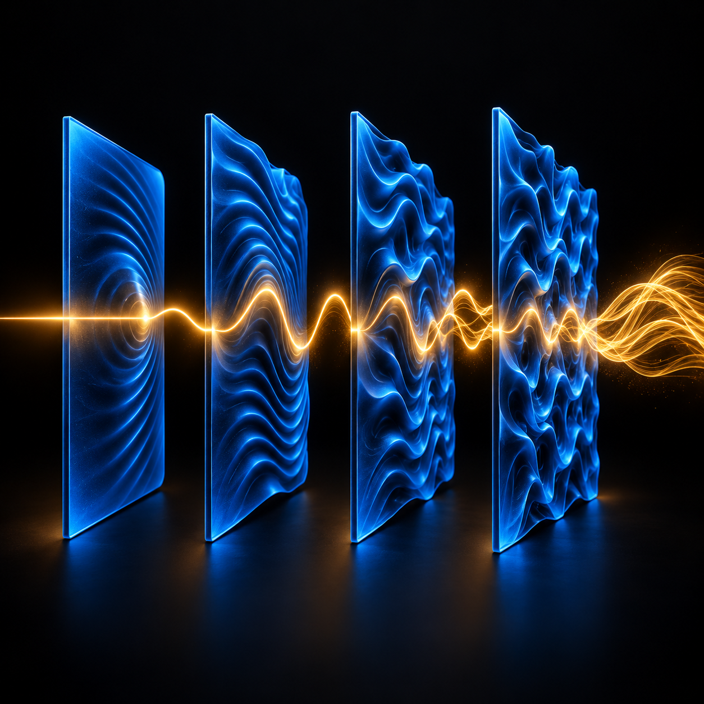

# Reverbulator SRS-4



Serial Reverbulator System: a four-macro reverb network that moves from useful
room ambience into unstable, nested spaces.

## Current controls

- MIX
- SPACE
- MOTION
- CHAOS
- BODY and HALO illuminated mode switches
- VECTOR illuminated topology switch (Layer 1 -> 3 -> 2 -> 4)
- one-digit mechanical factory-preset stepper with transient name display
- MASS meter driven by the wet network's energy

## DSP status

Layer 1 is a warm plate-to-room reverb with a lightly modulated short predelay,
CHAOS-controlled early reflections, and dedicated internal taps that will
bypass Layer 2 or Layers 2-3 when later reverbs arrive. SPACE completes this
layer's morph at 40%.

SPACE 0-5% is the wet network's ignition range. At exactly zero the reverb
network is silent; it fades smoothly to the original hard metallic minimum-
SPACE tank by 5%. This affects only the wet network, so MIX still determines
whether dry signal remains audible.

Layer 2 is a larger chorused reverb with opposing, slightly wandering stereo
motion. CHAOS adds chorus through 50%, increases movement speed through 90%,
then enters a deliberately extreme speed range. SPACE grows the tank across its
full travel, adds a low-cut return to Layer 1 from 30%, and introduces a small,
delayed self-return from 80%.

Chorus depth completes its movement at 50% MOTION. The upper half introduces a
separate 0.1-0.9 Hz equal-power spatial chopper, moving from centred sine panning
toward near-square hard-left/right alternation independently of CHAOS. Layer 2
also carries a gentle input limiter and correlation compensation so MOTION at
zero does not sound disproportionately loud.

Above 40% SPACE, the live input gradually moves out of Layer 1 and directly
into Layer 2. At maximum SPACE the input is divided equally between them.
BODY applies a smooth 6 dB/octave high cut at 9 kHz to every layer output;
HALO applies a 6 dB/octave low cut at 650 Hz. The filters also sit inside the
feedback topology, preventing discarded frequencies from circulating.
Layer 2's return to Layer 1 now enters only above 60% SPACE and reaches 1% at
maximum; its self-return enters above 90% and reaches 1.6%. Both paths carry a
permanent 12 dB/octave 470-550 Hz low cut and a two-pole high cut that darkens
from 5.2 kHz toward 3.4 kHz as SPACE rises. This makes feedback a final-region
texture rather than a competing decay engine.

At high SPACE, the direct feed into Layer 2 receives an additional 8% lift and
Layer 3 preserves up to 22% of Layer 2 directly (up from 18%). Together these
small changes keep the opposing stereo movement legible through the denser
late tail without pulling it in front of the reverb. From 45% SPACE, Layer 3
also preserves up to 16% of Layer 2's side signal without adding any centre
energy or altering mono input.

Listening note: a faint fuzzy saturation can sometimes be heard on attacks.
It is currently being left in place until the complete four-layer network can
be judged; likely contributors are the deliberate input limiters and tanh
guards around the feedback paths.

Layer 3 enters between 30% and 70% SPACE. It combines four input all-pass
diffusers, a bright eight-line prime-delay FDN, and four frequency-locked bands
that morph from octave to harmonic to inharmonic relationships under CHAOS.
MOTION moves the stereo filter roots through different five- and seven-step
sequences. Above 75% CHAOS, a 0.8-3 Hz stereo-offset flutter gently attenuates
the diffusion above 5 kHz by up to 2.35 dB. Layer 3 has no external feedback
return yet.

Each spectral band has its own left/right predelay, spreading from roughly
3-38 ms at low CHAOS and up to 5-56 ms at maximum. A tiny automatic root drift
prevents stationary filters from locking permanently to an FDN mode at zero
MOTION. SPACE reaches about 12 seconds of target decay at 90%, then rises
steeply toward a theoretical 90-second low-frequency RT60 at maximum.

The eight tank lines retain independent sub-millisecond fractional-delay drift
at rest, then add audible decorrelation across MOTION 0-25%. Layer 2 likewise
keeps a tiny internal chorus floor. Neither MOTION nor CHAOS can collapse these
stability motions to zero, preventing the extreme decay and serial return from
locking into modem-like pitches while keeping the 0% settings perceptually
calm. At zero CHAOS the tank is more strongly damped and the locked-band
contribution is minimal; CHAOS deliberately opens both as it rises.

Layer 4, the gravity bloom, enters from 55-85% SPACE. It receives Layer 3 plus
a 6-12% dry injection and the existing 6.5% warm Layer 1 tap. Two asymmetric
predelays reach 180/290 ms at 90% SPACE, then expand nonlinearly to 1.2/1.8
seconds at maximum. The first feeds a low-mid body tank; the second feeds a
bright, fully spread halo tank. Dry-envelope ducking lets both delayed arrivals
swell behind attacks, while MOTION drifts their times and moves them along
mismatched stereo trajectories. From 72% SPACE, a direct post-chorus tap also
fades in to a restrained 6.5% at maximum, with a further 4.5% applied only to
its side component. This preserves Layer 2's opposing stereo swirl when the
spectral and bloom tails become extremely dense without lifting the centre.

HALO now applies its 440 Hz low cut and broad 1.6 dB presence lift near 4.2 kHz
once, after the complete network, rather than compounding the filter at every
serial stage. When HALO is engaged above 75% SPACE, Layer 4 also fades in a dual-
window octave shimmer, reaching an 18% injection at maximum SPACE with slight
opposing stereo detune. Because the guarded total return listens after Layer 4,
these brittle shimmer fragments can recirculate only in the final 90-100%
SPACE region.

The complete Layer 4 output now gains a guarded spectral return to Layer 1 only
between 90-100% SPACE. An 83/117 ms drifting stereo delay feeds resonant bands
at 4.1, 7.7, and 13.1 kHz. The return tops out at 0.45%, with an envelope
governor, tanh guard, and absolute 1.2% ceiling. The band Q rises modestly only
in the final 10% of CHAOS. This is the intentionally "berserk" path, but its
failure boundaries are substantially harder than the earlier broadband loop.

VECTOR runs an alternate Layer 1 -> Layer 3 -> Layer 2 -> Layer 4 topology in
parallel with the normal Layer 1 -> Layer 2 -> Layer 3 -> Layer 4 chain. A
180 ms crossfade changes order without clicking or clearing either middle
tank. Layer 2's identity-based return and the guarded total return keep their
original destinations in both orders.

The final 90-100% of SPACE is an event-horizon region. Layer 3 now rises from
12 seconds at 90% toward a theoretical 90-second low-frequency RT60 at maximum,
while Layer 4 preserves up to 38% of that spectral tail. VECTOR also passes a
maximum 14% direct spectral tail around the chorused stage in this region. The
intent is an audible decay beyond 30 seconds without lengthening ordinary
settings or raising the guarded feedback ceilings.

MASS is calibrated to the wet network's actual RMS over a -60 to 0 dB scale.
Energy below -60 dB rests at the bottom instead of pinning the display with
inaudible numerical residue; the audio tail itself is never gated.

Factory programs use digit 0 for the neutral MANUAL starting state, followed
by 1 METAL TANK, 2 WARM EMS, 3 METAL STAIRWAY, 4 CHOPPER, 5 WHITE ARCH,
6 DEMON CRY, 7 EMPTY UNIVERSE, and 8 PURE HORROR. The upper and lower triangle
buttons step through them; the selected name appears briefly to the right.
After loading programs 1-8, changing any macro or mode turns the digit drum
red as a modified-preset warning. Reloading a factory program clears it;
MANUAL remains the unguarded free-edit state.

## Configure and build

```powershell
cmake -S . -B build -G Ninja -DREVERBULATOR_JUCE_SOURCE_DIR=F:/JUCE
cmake --build build --config Release
```

JUCE 9.0.1 is the reproducible reference version. GitHub Actions fetches that
tag automatically, runs the DSP regression suite, and produces downloadable
build archives for both platforms:

- Windows x64: Standalone and VST3
- macOS universal arm64/x86_64: Standalone, VST3, and Audio Unit

The macOS archive is currently unsigned and unnotarized. Local users may need
to approve it in Privacy & Security; release signing can be added later without
changing the DSP build.

Tagged versions are published as public GitHub Releases, so the Windows and
macOS ZIP files can be shared as ordinary download links without requiring a
GitHub account.

## Credits

- Original concept and creative direction: Monke Mountain Studios
- Software design and development: created in collaboration with OpenAI Codex
- Images and creative sounding board: ChatGPT

## License

Reverbulator SRS-4 is free software licensed under the GNU Affero General
Public License v3.0 (AGPL-3.0-only). JUCE is a separate dependency offered
under its own AGPLv3/commercial dual-license terms. Anyone distributing a
closed-source build must arrange and comply with the appropriate JUCE license.
